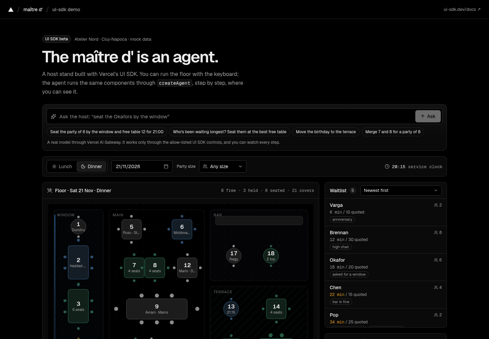

# Maître d'

A restaurant host stand that an AI agent runs by operating the real UI, not by chatting.

Ask "Seat the party of 6 by the window and free table 12 for 21:00" and you watch the agent work: candidate tables pulse on the floor plan, the waitlist reorders, the party gets selected, the **Confirm seating** dialog opens and is confirmed, and every step lands in an `agent.act()` trail with the exact UI SDK call it made.

Live at **https://ui-sdk-maitre-d.vercel.app**.



Built with Vercel's [UI SDK](https://ui-sdk.dev) (`@ui-sdk/react` 0.1.0-beta.9), the [AI SDK](https://ai-sdk.dev) and [AI Gateway](https://vercel.com/ai-gateway). Sister demo of [ui-sdk-flights](https://github.com/Matiaaspoblete/ui-sdk-flights).

## What's on screen

Atelier Nord is a fictional restaurant in Cluj-Napoca. Tonight's dinner has 18 tables (2, 4, 6 and 8 seats) in four zones: Window, Main, Terrace and Bar. Each table is free, reserved, seated or cleaning. Every control is a UI SDK component, usable with the keyboard:

| Control | UI SDK component | Agent action |
| --- | --- | --- |
| Lunch / Dinner switch | `Tabs` ("Service") | `setValue` |
| Service date | `DatePicker` ("Date") | `setValue` |
| Party size filter, which dims tables that are too small | `Select` ("Party size") | `setValue` |
| Floor plan: each table is an option, ⌘/Ctrl adds a second table to push together | `Listbox multiple` ("Floor plan") | `setValue` |
| Walk-ins with wait and quote times and notes (birthday, high chair, accessible…) | `Listbox` ("Waitlist") + `Select` ("Sort by") | `setValue` |
| Reservations timeline | `Listbox` ("Reservations") | `setValue` |
| Status of the selected table | `Select` ("Table status") | `setValue` |
| Seating confirmation with capacity and conflict checks | `Dialog` + `Button` ("Review seating", "Confirm seating") | `press` |

All state lives in the browser. There's no database; reload to reset. Tonight's dinner runs on a simulated service clock that starts at 20:15 and ticks in real time, so the demo works at any hour. Other dates are a planning view: reservations can be moved but nobody can be seated.

## How the agent works

1. The **Ask the host** box sends the request and a compact description of the floor to `/api/agent`.
2. The route calls `streamText` from the AI SDK with the plain model string `openai/gpt-4.1-mini`. AI Gateway resolves it and authenticates with the deployment's Vercel OIDC token, so there is no API key. Set `AGENT_MODEL` to use another Gateway model. The system prompt includes the real local time in Cluj-Napoca and the service clock.
3. The tools have no `execute`, so they run on the client. Each tool call becomes one or more UI SDK steps through `createAgent().act()`:

   ```ts
   // seat({ mode: "seat" })
   await agent.act({ steps: [{ ref: "Review seating", action: "press" }] })
   await agent.act({ steps: [{ ref: "Confirm seating", action: "press", args: ["Seat now"] }] })
   ```

4. `createAgent({ allow })` only accepts the label and action pairs in `src/demo/agent.ts` and refuses anything with a `confirm` mark. The prompt box and the trail are marked `data-agent-hidden`.
5. Errors go back to the model. For example, if a table is held for another booking, the dialog shows the conflict and the model gets "Table 15 is held for Sandu at 21:30." so it can pick another table.

| Tool | What it does on screen |
| --- | --- |
| `consider_tables` | Pulses the candidate tables. Visual only. |
| `set_service`, `set_date`, `set_party_size`, `sort_waitlist` | Drive the Tabs, DatePicker and Selects. |
| `select_party` | Selects a walk-in in the Waitlist or a booking in Reservations. |
| `select_tables` | Selects one table, or a mergeable pair (7 + 8, 10 + 11). |
| `seat` (`seat` or `assign`) | Opens the Confirm seating dialog and presses **Seat now** or **Assign table**. |
| `set_table_status` | Selects a table and sets it to Free or Cleaning. |

Example requests:

- Seat the party of 6 by the window and free table 12 for 21:00
- Who's been waiting longest? Seat them at the best free table
- Move the birthday to the terrace
- Merge 7 and 8 for a party of 8

### Lessons carried over from ui-sdk-flights

- Give the model the current local time, or "now" and "next" are guesses.
- Item names come from their text, so keep codes and ids out of what the bridge reads: each row has a screen-reader description, and the visual details are `aria-hidden`.
- Labels must not share words. A ref like "Waitlist" also matches "Sort waitlist", so the sort control is called "Sort by".

## Limits

`/api/agent` keeps in-memory limits that are fine for a demo:

- per IP: 8 requests and 60 model calls (including tool round-trips) every 10 minutes
- 1,500 model calls a day per instance
- per request: 10 tool calls, 400 characters of input and 400 output tokens

For real traffic, move these to Redis or Vercel Firewall rate limiting and set an AI Gateway budget.

## Run it

```bash
npm install
npx vercel link && npx vercel env pull   # gives the dev server a Vercel OIDC token for AI Gateway
npm run dev
```

Without Gateway credentials the page still works by hand, and the agent explains that it can't reach the Gateway.

```bash
npm run typecheck && npm run lint && npm run build
```

## Files

- `src/demo/floor-data.ts`: floor layout, tonight's scenario, generated services and the seating checks
- `src/demo/host-stand.tsx`: the page, and how each tool turns into `agent.act()` steps
- `src/demo/floor-plan.tsx`: the floor plan as a multiple-selection `Listbox`
- `src/demo/agent.ts`: `createAgent` and the allow-list
- `src/agent/tools.ts`, `src/app/api/agent/route.ts`: tool schemas, system prompt, limits
